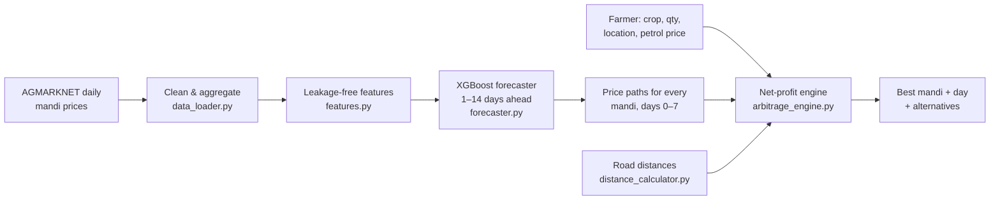

# 🌾 Mandi Intelligence — Smart Market Arbitrage Engine

**Where and when should a farmer sell?** Mandi Intelligence forecasts Onion, Tomato and Potato prices at Gujarat mandis for the next 7 days, then recommends the mandi and day that give the highest **net profit**. That is the price *after* transport, storage and spoilage are paid for, not the highest headline price.

Part of the **BeejRakshak** ecosystem.

```
"Sell at Mehsana TODAY"
Sell at Mehsana (62 km) now at today's price ₹26.54/kg. After ₹2,779 transport
(fuel ₹486 + driver ₹585 + tolls + maintenance + loading), net profit is ₹50,301
for 2,000 kg of Onion.
```

---

## Why net profit?

The mandi with the best price is often not the best place to sell. A mandi 280 km away paying ₹1/kg more can lose money once the truck, driver, tolls and a day of spoilage are counted. Mandi Intelligence compares every option side by side:

| Cost | How it's modelled |
| :-- | :-- |
| **Transport** | Fuel (adjustable petrol price) + driver wages + tolls (NH/SH blend) + maintenance + loading/unloading. The vehicle is chosen by load (Mini Truck → LCV → Medium → Heavy), with extra trips when the load doesn't fit. |
| **Storage** | ₹50 per quintal per day while waiting for a better price |
| **Spoilage** | Exponential decay, `qty × e^(−λ·days)`. Tomatoes (λ = 0.055) spoil faster than onions (0.030) or potatoes (0.020). |
| **Uncertainty** | Forecasts come with 80 % prediction intervals. The engine only advises waiting when the expected gain outweighs the risk. |

---

## How it works



1. **Data.** Daily modal prices are cleaned up: mandi names are standardised, varieties and sub-yards are combined into one daily median per mandi, and obvious typos are removed. Real price spikes are kept.
2. **Forecasting.** One XGBoost model per crop learns from all mandis at once. It directly predicts the price change *h* days ahead (h = 1…14), using only information available on the forecast day: recent trends, volatility, how a mandi compares with the Gujarat average, and last year's seasonal pattern.
3. **Decision.** For every mandi and every waiting period from 0 to 7 days, the engine computes net profit and its uncertainty range, then picks the best risk-adjusted option.

---

## Accuracy

These numbers come from a **held-out test period** (Mar–Dec 2024). The model never saw these dates during training or tuning. Figures are averaged across the three crops.

| Forecast horizon | Error (MAE) | Error % (MAPE) | vs. "price stays the same" |
| :-- | --: | --: | --: |
| 1 day | ₹0.82/kg | 4.6 % | **28 % lower error** |
| 7 days | ₹0.82/kg | 4.6 % | **33 % lower error** |
| 14 days | ₹0.81/kg | 4.6 % | **45 % lower error** |

Per-crop results, including comparison baselines, are in [`reports/MODEL_REPORT.md`](reports/MODEL_REPORT.md).

> **Note on earlier versions.** v3 reported ₹0.29/kg MAE and R² 0.993. That figure came from *data leakage*: the training inputs included the very price being predicted. Measured honestly, v3 scored ₹1.03–1.14/kg; v4 reduces that error by 20–28 %. See [FINAL_DOCUMENTATION.md](FINAL_DOCUMENTATION.md) for the full story.

**Speed:** the API starts in **~1.4 s** (it loads saved models instead of retraining), and a recommendation takes **~7 ms**.

---

## Quick start

**Requirements:** Python 3.10+, and Node 18+ for the web UI.

```bash
git clone https://github.com/yatrik-15/Mandi-Intelligence-Smart-Market-Arbitrage-Engine.git
cd Mandi-Intelligence-Smart-Market-Arbitrage-Engine
pip install -r requirements.txt
```

**Start the API**

```bash
uvicorn api.ml_api:app --port 8000
```

Interactive API docs are at http://localhost:8000/docs.

**Start the web UI** (in a second terminal)

```bash
cd frontend
npm install
npm run dev          # http://localhost:3000
```

**Or use the command line**

```bash
python scripts/recommend.py --crop Tomato --qty 1500 --location Rajkot
```

---

## API

| Method | Endpoint | Description |
| :-- | :-- | :-- |
| `POST` | `/recommend` | Best mandi and day to sell (main endpoint) |
| `GET` | `/health` | Service status, data coverage |
| `GET` | `/mandis` | Active mandis, crops and distance from Gandhinagar |
| `GET` | `/locations` | Towns accepted as `farmer_location` |
| `GET` | `/model_report` | Held-out accuracy per crop and horizon |
| `GET` / `POST` | `/config/petrol` | Read / set the default petrol price (₹/L) |
| `POST` | `/respond` | Record an actual sale (feedback) |

**Example**

```bash
curl -X POST http://localhost:8000/recommend \
  -H "Content-Type: application/json" \
  -d '{"crop": "Onion", "quantity": 2000, "farmer_location": "Gandhinagar"}'
```

```jsonc
{
  "recommendation": "Sell at Mehsana TODAY",
  "best_option": {
    "mandi_name": "Mehsana",
    "distance_km": 62.0,
    "current_price": 26.54,        // ₹/kg
    "days_to_wait": 0,
    "gross_revenue": 53080.0,
    "transport_cost": 2779.13,
    "storage_cost": 0.0,
    "net_profit": 50300.87,
    "net_profit_lower": 50300.87,  // 80% range (wider when waiting)
    "net_profit_upper": 50300.87,
    "predicted_price_7d": 25.92,
    "cost_breakdown": { "transport_detail": { "vehicle": "LCV", "trips": 1, "fuel": 486.0, "...": "..." } }
  },
  "alternatives": [
    { "mandi_name": "Ahmedabad", "distance_km": 26.0, "current_price": 24.61, "net_profit": 47063.83, "days_to_wait": 0 },
    { "mandi_name": "Amreli",   "distance_km": 277.0, "current_price": 26.55, "net_profit": 46600.42, "days_to_wait": 0 }
  ],
  "justification": "Sell at Mehsana (62 km) now at today's price ₹26.54/kg. ..."
}
```

| Field | Type | Notes |
| :-- | :-- | :-- |
| `crop` | string | `Onion`, `Tomato` or `Potato` (case-insensitive) |
| `quantity` | number | kg, up to 100,000 |
| `farmer_location` | string | Gujarat town (see `/locations`); default `Gandhinagar` |
| `petrol_price` | number | optional, ₹/L |

---

## Data

| Source | Coverage | Notes |
| :-- | :-- | :-- |
| `dataset/commodity_price.csv` (bundled) | 7 mandis, 2021–2024 | Used to train the shipped models. It is unusually complete (one report every day), so treat it as demo data. |
| [AGMARKNET via data.gov.in](https://www.data.gov.in/resource/variety-wise-daily-market-prices-data-commodity) | 30+ Gujarat mandis, updated daily | Official Ministry of Agriculture data. Download it with `scripts/fetch_agmarknet.py`. |

**Training on live data**

```bash
export DATA_GOV_IN_API_KEY=<free key from data.gov.in>   # optional; the public key is slow
python scripts/fetch_agmarknet.py --start 2023-01-01     # resumable, newest days first
MANDI_DATASET=dataset/agmarknet_gujarat.csv python scripts/train.py
MANDI_DATASET=dataset/agmarknet_gujarat.csv uvicorn api.ml_api:app --port 8000
```

The API retrains automatically at startup if the saved models were trained on a different dataset.

---

## Project structure

```
├── api/
│   └── ml_api.py              FastAPI app
├── ml_arbitrage/
│   ├── data_loader.py         raw CSV → clean daily price panel
│   ├── features.py            leakage-free multi-horizon features
│   ├── forecaster.py          per-crop XGBoost: train, evaluate, save, forecast
│   ├── arbitrage_engine.py    transport / storage / spoilage → recommendation
│   ├── distance_calculator.py road distances between 65 Gujarat towns
│   └── service.py             loads data + models, caches forecasts
├── scripts/
│   ├── fetch_agmarknet.py     download live prices
│   ├── train.py               retrain + write reports/MODEL_REPORT.md
│   └── recommend.py           command-line recommendations
├── models/                    trained models (.ubj) + metrics (.meta.json)
├── reports/MODEL_REPORT.md    held-out accuracy tables
├── dataset/                   training data
├── tests/                     pytest suite
└── frontend/                  Nuxt 3 + Tailwind web UI
```

---

## Development

```bash
python -m pytest tests -q      # leakage, profit maths, distances, API contract
python scripts/train.py        # retrain (~45 s) and refresh the report
```

**Tuning knobs**
- Costs and vehicle profiles: top of `ml_arbitrage/arbitrage_engine.py`
- Risk aversion (how cautious the "wait" advice is): `RISK_AVERSION` in the same file
- Spoilage rates: `PERISHABILITY` in the same file
- Model hyperparameters: `XGB_PARAMS` in `ml_arbitrage/forecaster.py`

---

## Limitations

- The shipped models are trained on the bundled 2021–2024 data, so "today" in the API is 31 Dec 2024. Retrain on live AGMARKNET data for current advice.
- Costs are Gujarat averages (as of March 2026). Real truck rates, tolls and mandi fees vary.
- Prices are mandi *modal* prices. What a farmer actually gets also depends on grade and quality.
- Forecasts can't anticipate shocks such as export bans or sudden weather damage. Use the uncertainty range, not just the point estimate.
